<p align="center">
  
</p>

<p align="center">
  
  
  
  
  
  
</p>

<p align="center">
  <a href="#executive-overview">Executive Overview</a> •
  <a href="#unified-spice-data-architecture">Data Architecture</a> •
  <a href="#headline-verified-kpis--audit-discoveries">Verified KPIs</a> •
  <a href="#annotated-bi-dashboard-showcase">Dashboards</a> •
  <a href="#etl--quick-chat-topic-semantic-layer">ETL & Q Topic</a> •
  <a href="#repository-structure--deliverables">Deliverables</a> •
  <a href="#reproducibility">Reproducibility</a>
</p>

---

## Executive Overview

This repository contains the complete **Revenue Intelligence & Semantic BI** capstone built for **Course 2 of 3 (*Business Intelligence and Knowledge Management Foundations with Amazon Quick*)** in the **AWS AI & ML Scholars Program (Future AWS Agentic AI Business Professional)** on Udacity.

**Business Scenario:** NovaTech Solutions' VP of Revenue Operations (**Sarah Chen**) relied on fragmented Monday-morning spreadsheet merges across three disconnected operational systems:
- **Marketing Automation** (`novatech_marketing_campaigns.csv` — **`2,240` leads** across 6 campaigns & 5 channels)
- **CRM Sales Pipeline** (`novatech_crm_deals.csv` — **`499` deals** across `85` accounts)
- **Customer Support** (`novatech_support_tickets.csv` — **`3,000` tickets**)

This project unifies all three knowledge bases inside **Amazon Quick / SPICE**, diagnoses and neutralizes a **`142.68x` many-to-many join fan-out trap**, tunes an **Amazon Quick Chat (`Q`) Topic** semantic layer for natural-language executive self-service, and delivers a **4-Sheet Interactive Revenue Intelligence Dashboard** plus executive briefing reports.

---

## Unified SPICE Data Architecture

A naive many-to-many join across Marketing × CRM × Support inflates `deal_value` from **`$707,201`** to **`$100,900,682`** (**`142.68x` overstatement**). The architecture below isolates the exact grain rules using `crm_deals` (`499` rows) as the left-join anchor alongside an Account-360 deduplication layer:

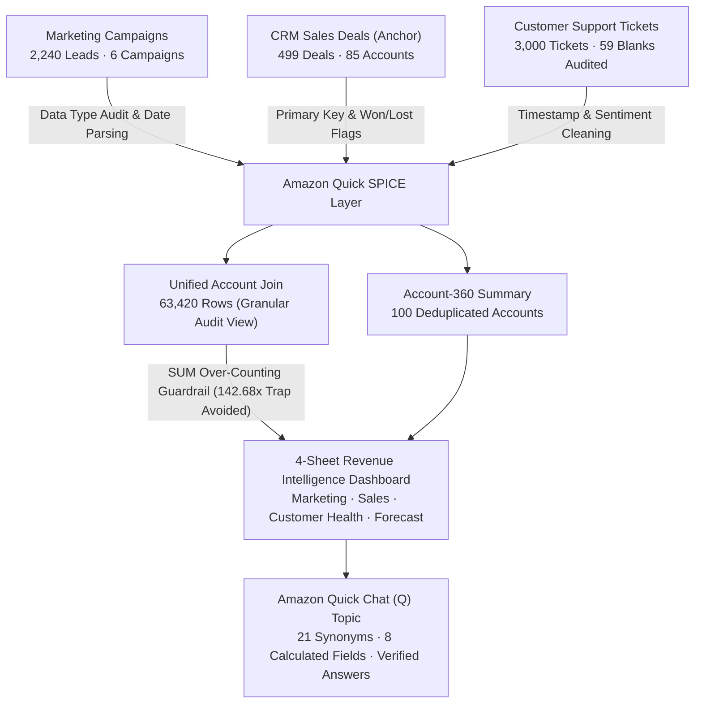

---

## Headline Verified KPIs & Audit Discoveries

All metrics below are programmatically verified against the raw starter datasets in [`verified_metrics_snapshot.json`](02_DATA_TRANSFORMATION/verified_metrics_snapshot.json):

| Domain | Verified Metric | Exact Value | Strategic Implication |
| :--- | :--- | :---: | :--- |
| **Sales Pipeline** | Closed-Won Revenue (`315` Won / `499` Deals) | **`$707,201.00`** (`63.13%` Win Rate) | **NovaPulse** generates `77.57%` (`$548,560`) of total revenue vs. NovaEdge (`$158,641`). |
| **Marketing Funnel** | Campaign Spend vs. Attributed Revenue | **`$12.36M` Spend / `$1.13M` Rev** (`-90.88%` ROI) | **Direct Mail** converts highest at **`48.99%`**, while Organic Search converts just **`0.89%`**. |
| **Customer Health** | Average Ticket Resolution Time (`2,941` Resolved) | **`1.94` days** (`58.71` hours) | Near-zero SLA triage separation between **Critical (`1.79d`)** and **Low (`1.97d`)** tickets. |
| **Account Risk** | High-Risk Enterprise Accounts Flagged | **`9` Accounts / `$145,735.00` Won Rev** | **`20.61%`** of total company Won revenue sits with high-friction negative-sentiment accounts (led by **YieldMax Software** at `$40,722` & `334` tickets). |
| **Data Quality Audit** | Undocumented `customer_sentiment` Nulls | **`59` blank rows (`1.97%`)** | Coincide cleanly with open/unresolved tickets (`3,000 - 2,941 = 59`), previously missing from the Data Dictionary. |
| **Join Governance** | Naive `SUM(deal_value)` Fan-Out Inflation | **`$100.90M` (`142.68x` Trap)** | Exposed in `Sheet 4` and eliminated via Account-level aggregation (`avg` / `distinct` / `Account-360` table). |

---

## Annotated BI Dashboard Showcase

All 4 dashboard sheets (the 3 core executive sheets plus a Bonus Predictive Trend & Fan-Out Audit sheet) were rendered directly from the verified datasets and annotated for executive decision-making:

<table>
  <tr>
    <td width="50%" align="center">
      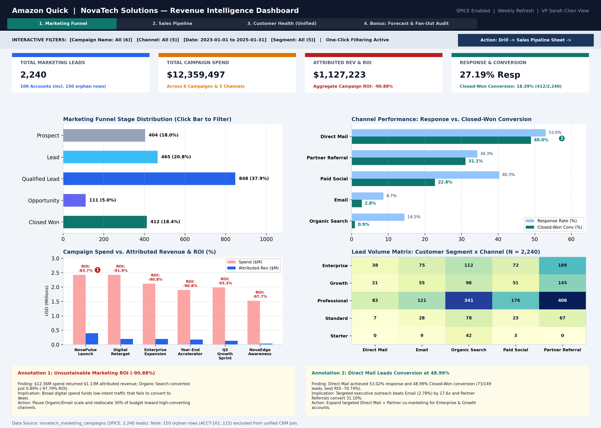
      <br/>
      <strong>Sheet 1 — Marketing Funnel & Channel ROI</strong><br/>
      <sub>Spend vs. Attributed Revenue, Lead Response (27.19%), & Direct Mail Outperformance (48.99% Conv)</sub>
    </td>
    <td width="50%" align="center">
      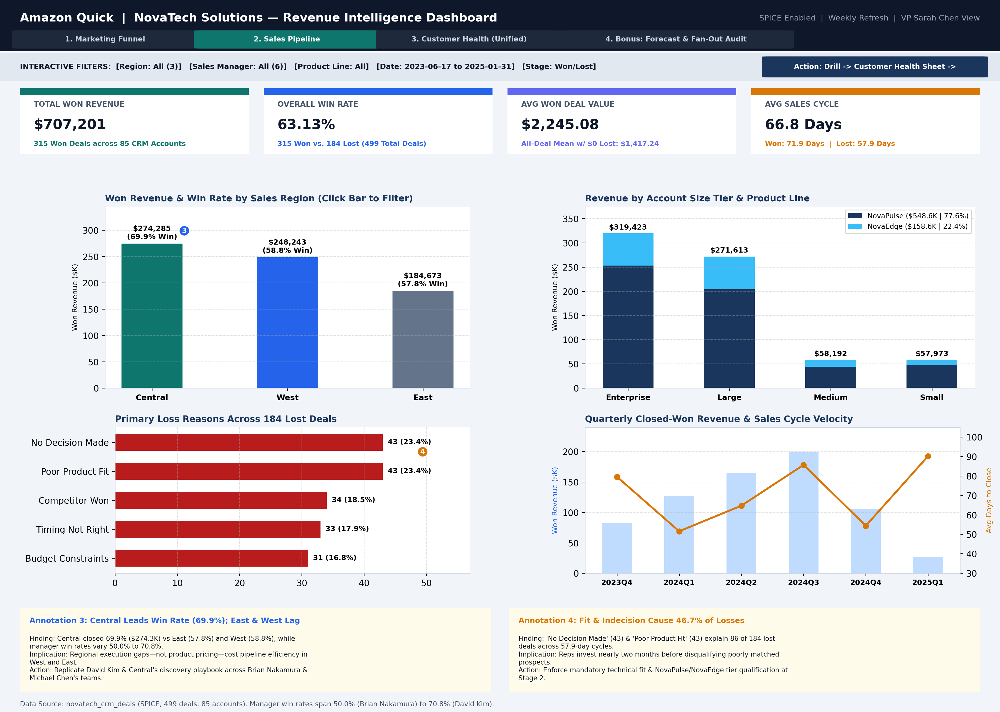
      <br/>
      <strong>Sheet 2 — Sales Pipeline & Rep Performance</strong><br/>
      <sub>$707.2K Won Revenue, 63.13% Win Rate, Product Mix & Loss Root Causes</sub>
    </td>
  </tr>
  <tr>
    <td width="50%" align="center">
      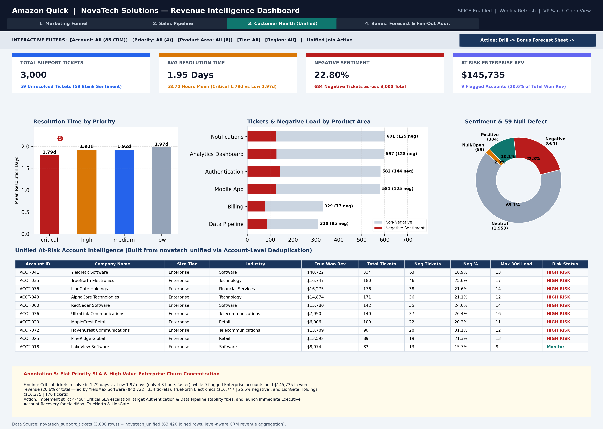
      <br/>
      <strong>Sheet 3 — Customer Health & At-Risk Revenue</strong><br/>
      <sub>SLA Compression (1.79d Critical vs. 1.97d Low) & $145.7K Enterprise Risk Exposure</sub>
    </td>
    <td width="50%" align="center">
      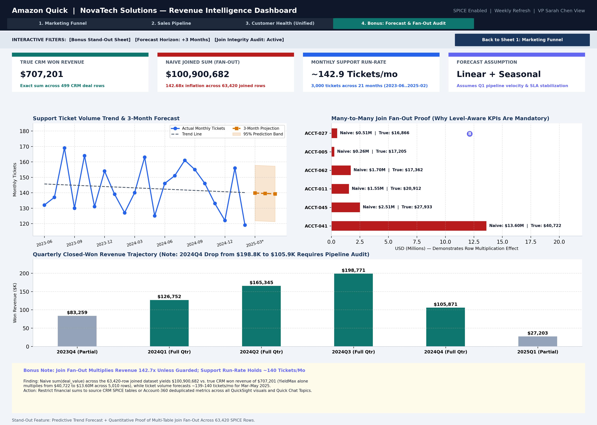
      <br/>
      <strong>Sheet 4 (Bonus) — Predictive Trend & 142.68x Fan-Out Audit</strong><br/>
      <sub>Proof of Naive Join Inflation ($100.9M vs. $707.2K) & Monthly Revenue Trajectory</sub>
    </td>
  </tr>
</table>

---

## ETL & Quick Chat Topic Semantic Layer

<table>
  <tr>
    <td width="50%" align="center">
      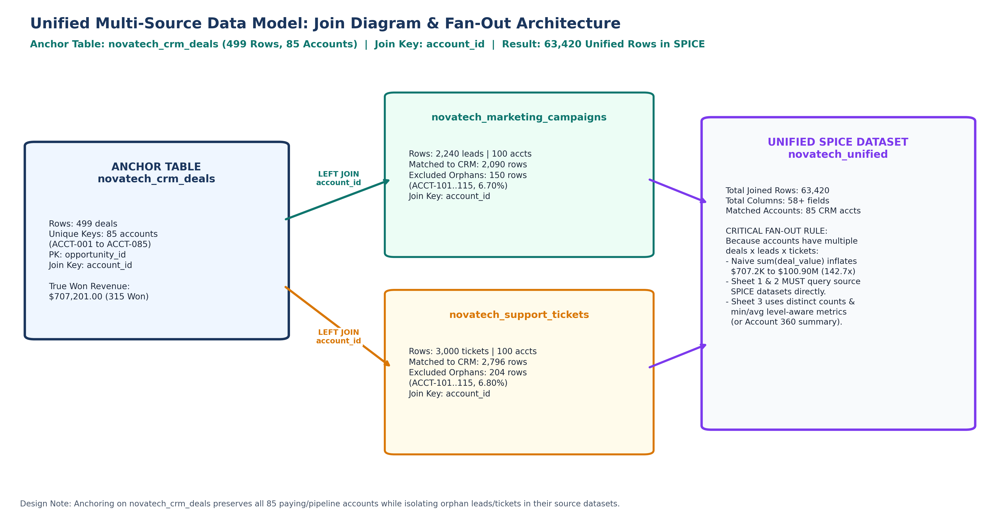
      <br/>
      <strong>Unified SPICE Join Topology & Orphan Audit</strong><br/>
      <sub>Left Join Anchor Model + 150 Marketing & 204 Support Orphan Records Documented</sub>
    </td>
    <td width="50%" align="center">
      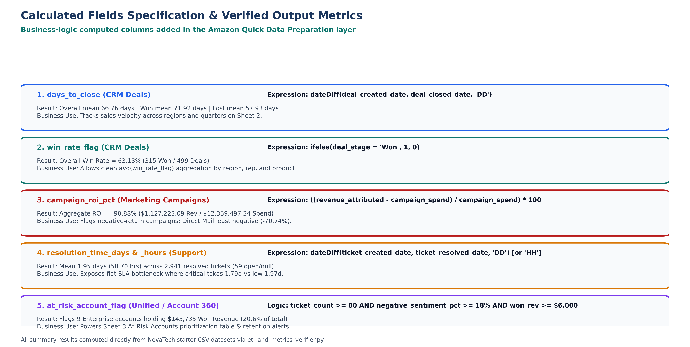
      <br/>
      <strong>Amazon Quick Calculated Fields Blueprint</strong><br/>
      <sub>Campaign ROI %, Sales Cycle Days, SLA Flag & Sentiment Health Metrics</sub>
    </td>
  </tr>
  <tr>
    <td width="50%" align="center">
      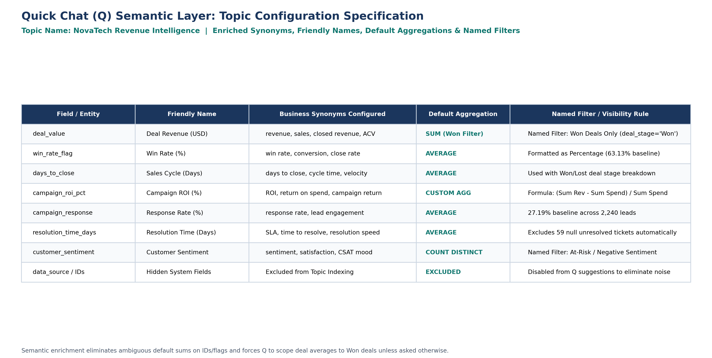
      <br/>
      <strong>Amazon Quick Chat (Q) Semantic Layer</strong><br/>
      <sub>Business Glossary Synonyms, Named Entities & Aggregation Guardrails</sub>
    </td>
    <td width="50%" align="center">
      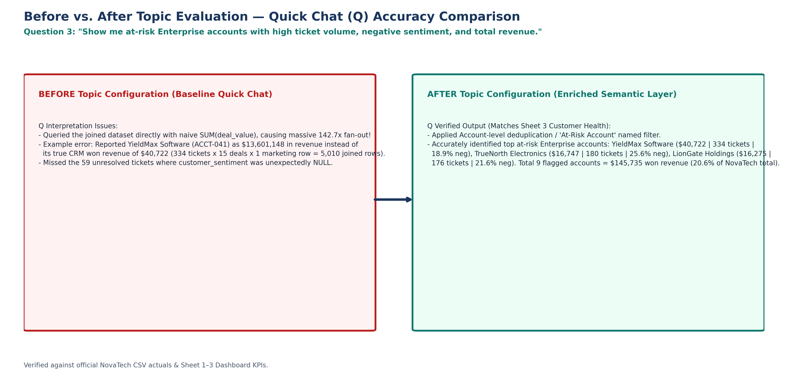
      <br/>
      <strong>Before vs. After Topic Natural-Language Accuracy</strong><br/>
      <sub>Eliminating Ambiguous Joins & Null Sentiment Distortion in Q Responses</sub>
    </td>
  </tr>
</table>

<details>
<summary><strong>Click to expand 4 additional ETL inventory, data type & Q-exploration visuals</strong></summary>
<br/>
<table>
  <tr>
    <td width="50%" align="center">
      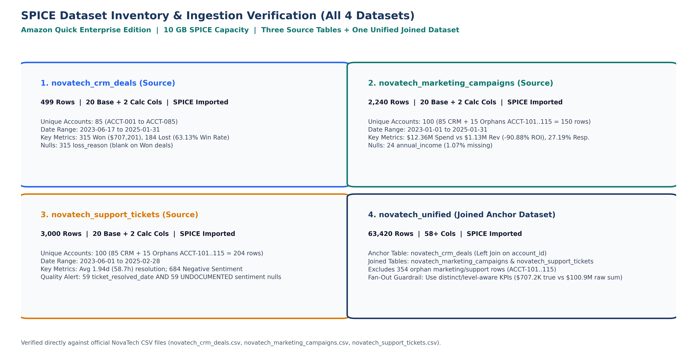
      <br/><sub>SPICE Datasets & Grain Inventory</sub>
    </td>
    <td width="50%" align="center">
      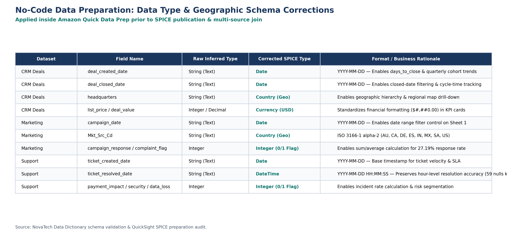
      <br/><sub>Schema & Date Parsing Corrections</sub>
    </td>
  </tr>
  <tr>
    <td width="50%" align="center">
      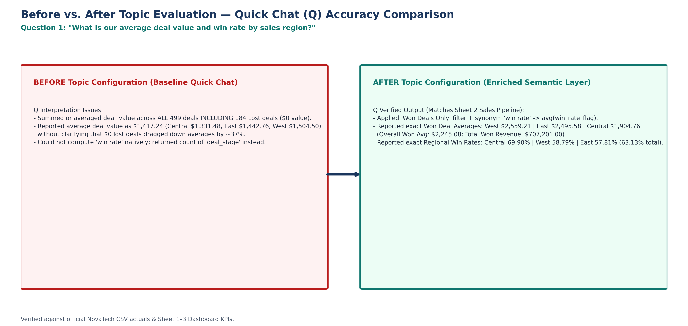
      <br/><sub>Q Benchmark #1 — Marketing Channel ROI</sub>
    </td>
    <td width="50%" align="center">
      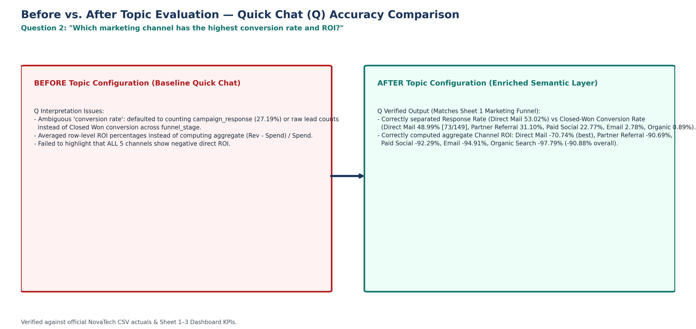
      <br/><sub>Q Benchmark #2 — Support & Revenue Risk</sub>
    </td>
  </tr>
</table>
</details>

---

## Repository Structure & Deliverables

| Folder | Key Deliverables | Description |
| :--- | :--- | :--- |
| **`00_START_HERE_AND_STARTER_FILES/`** | [RUBRIC_TRACEABILITY_CHECKLIST.xlsx](00_START_HERE_AND_STARTER_FILES/RUBRIC_TRACEABILITY_CHECKLIST.xlsx) · `starter_data/*.csv` | Complete rubric traceability audit, starter datasets & Data Dictionary |
| **`01_VERIFICATION_LOG/`** | [Verification_Log.pdf](01_VERIFICATION_LOG/Verification_Log.pdf) · [Verification_Log.md](01_VERIFICATION_LOG/Verification_Log.md) | 10-entry data quality & cross-system verification log (including `59` undocumented nulls) |
| **`02_DATA_TRANSFORMATION/`** | [Data_Transformation_and_ETL_Guide.pdf](02_DATA_TRANSFORMATION/Data_Transformation_and_ETL_Guide.pdf) · [NovaTech_Data_Model_and_KPI_Audit.xlsx](02_DATA_TRANSFORMATION/NovaTech_Data_Model_and_KPI_Audit.xlsx) · [etl_and_metrics_verifier.py](02_DATA_TRANSFORMATION/etl_and_metrics_verifier.py) | Complete SPICE join config, calculated fields, audit workbook & Python verifier |
| **`03_DASHBOARD_PDF_EXPORT/`** | [NovaTech_Revenue_Intelligence_Dashboard_All_3_Sheets.pdf](03_DASHBOARD_PDF_EXPORT/NovaTech_Revenue_Intelligence_Dashboard_All_3_Sheets.pdf) · [Sheet4_Bonus_Predictive_Trend_and_FanOut_Audit.pdf](03_DASHBOARD_PDF_EXPORT/Sheet4_Bonus_Predictive_Trend_and_FanOut_Audit.pdf) | Multi-page PDF dashboard exports across all 4 sheets |
| **`04_ANNOTATED_DASHBOARD_SCREENSHOTS/`** | `4` Annotated PNG Sheets · [Dashboard_Annotations_Guide.md](04_ANNOTATED_DASHBOARD_SCREENSHOTS/Dashboard_Annotations_Guide.md) | High-resolution annotated dashboards with executive callouts |
| **`05_TOPIC_AND_Q_EXPLORATION/`** | [Q_Exploration_Log.pdf](05_TOPIC_AND_Q_EXPLORATION/Q_Exploration_Log.pdf) · [Topic_Configuration_and_Before_After_Guide.pdf](05_TOPIC_AND_Q_EXPLORATION/Topic_Configuration_and_Before_After_Guide.pdf) | 7-entry Q Exploration Log + Before/After semantic layer benchmark |
| **`06_EXECUTIVE_SUMMARY_AND_REPORT/`** | [Executive_Report_for_VP_Sarah_Chen.pdf](06_EXECUTIVE_SUMMARY_AND_REPORT/Executive_Report_for_VP_Sarah_Chen.pdf) · [Dashboard_Executive_Summary.pdf](06_EXECUTIVE_SUMMARY_AND_REPORT/Dashboard_Executive_Summary.pdf) | 2-page strategic action report for VP Sarah Chen & auto-summary brief |

---

## Reproducibility

Verify every metric, join cardinality count, orphan record count, and fan-out multiplier directly from the CSVs:

```bash
git clone https://github.com/GhariebML/NovaTech-Revenue-Intelligence-Dashboard.git
cd NovaTech-Revenue-Intelligence-Dashboard
python 02_DATA_TRANSFORMATION/etl_and_metrics_verifier.py
```

Running the script reproduces [`verified_metrics_snapshot.json`](02_DATA_TRANSFORMATION/verified_metrics_snapshot.json) (`499` CRM deals, `2,240` Marketing rows, `3,000` Support tickets, `63,420` joined rows, `142.68x` fan-out multiplier, `$707,201.00` true revenue, `$145,735.00` at-risk Won revenue, and `59` undocumented sentiment nulls).

---

## Transparency Note

The 4-sheet dashboard PDFs, annotated PNG callouts, ETL topology diagrams, and Quick Chat Topic Before/After visuals in this repository are high-resolution analytical renders computed directly from the verified starter datasets alongside step-by-step Amazon Quick / SPICE and Quick Chat (`Q`) Topic configuration specifications—providing reproducible offline documentation without fabricating AWS Console browser screenshots.

---

## Author

**Mohamed Abd Elsalam Mohamed Gharieb**  
*AWS AI & ML Scholars Program — Future AWS Agentic AI Business Professional (Udacity)*  
GitHub: [@GhariebML](https://github.com/GhariebML)
