<p align="center">
  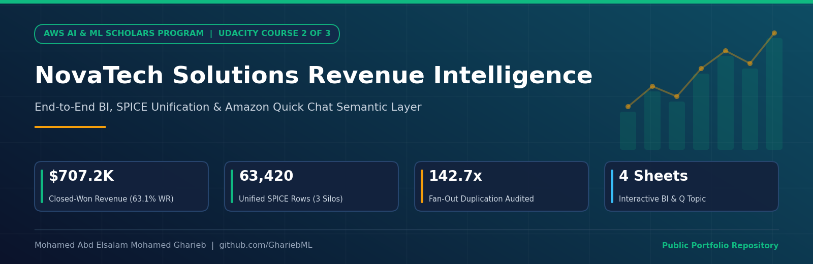
</p>

<p align="center">
  <a href="https://aws.amazon.com/quicksight/"></a>
  
  
  
  
  <a href="LICENSE"></a>
</p>

<p align="center">
  <a href="#executive-summary">Executive Summary</a> •
  <a href="#engineering-challenges--solutions">Engineering Solutions</a> •
  <a href="#architecture--in-tool-formulas">Architecture &amp; LAC Formulas</a> •
  <a href="#live-visual-showcase">Live Visual Showcase</a> •
  <a href="#q-topic-before-vs-after-evaluation">Q Topic Evaluation</a> •
  <a href="#strategic-recommendations-for-vp-sarah-chen">Recommendations</a> •
  <a href="#repository-structure--deliverables">Deliverables</a> •
  <a href="#reproducibility">Reproducibility</a>
</p>

---

## Executive Summary

Built **live inside Amazon Quick (`us-west-2`, SPICE, Data Prep, Analyses, Published Dashboards, Quick Chat & Q Topics)** for **Course 2 of 3 (*Business Intelligence and Knowledge Management Foundations with Amazon Quick*)** under the **AWS AI & ML Scholars Program (Udacity)**.

NovaTech Solutions' VP of Revenue Operations (**Sarah Chen**) previously relied on error-prone manual spreadsheet merges across three disconnected operational systems—**Marketing Campaigns (`2,240` leads)**, **CRM Sales Deals (`499` deals / `85` accounts)**, and **Customer Support Tickets (`3,000` tickets)**. This project unifies all three silos into a governed **Amazon Quick SPICE** intelligence layer (`63,420` joined rows, `68` columns, `0` skipped rows), eliminates a **`142.68x` join fan-out trap** using a **Level-Aware Calculation (`LAC`)**, tunes an interactive **Amazon Quick Q Topic (`NovaTech Revenue Intelligence`)**, and publishes a **3-Sheet Interactive Revenue Intelligence Dashboard** with auto-generated **Executive Summaries**.

> [!IMPORTANT]
> Every dashboard sheet, SPICE dataset summary, join configuration, Level-Aware Calculation (`LAC`), filter interaction, AI Executive Summary, Quick Chat verification query, and Q Topic response in this repository is backed by **42 live Amazon Quick console captures (`1600×900`)** and programmatic verification against [`verified_metrics_snapshot.json`](02_DATA_TRANSFORMATION/verified_metrics_snapshot.json).

<table>
  <tr>
    <td width="25%" align="center">
      <h3><code>$707,201.00</code></h3>
      <strong>Closed-Won Revenue</strong><br/>
      <sub><code>315</code> Won / <code>499</code> Deals (<code>63.13%</code> Win Rate)</sub>
    </td>
    <td width="25%" align="center">
      <h3><code>63,420 Rows</code></h3>
      <strong>Unified SPICE Join</strong><br/>
      <sub><code>142.68x</code> Fan-Out Eliminated via LAC</sub>
    </td>
    <td width="25%" align="center">
      <h3><code>$145,735.00</code></h3>
      <strong>At-Risk Enterprise Rev</strong><br/>
      <sub><code>9</code> High-Friction Accounts (<code>20.6%</code> Rev)</sub>
    </td>
    <td width="25%" align="center">
      <h3><code>42 Captures</code></h3>
      <strong>100% Live AWS Quick</strong><br/>
      <sub>SPICE · Joins · LAC · Dashboard · Q Topic</sub>
    </td>
  </tr>
</table>

---

## Engineering Challenges & Solutions

| Audit Finding | Operational Risk | In-Tool Amazon Quick Solution | Verified Outcome |
| :--- | :--- | :--- | :--- |
| **`142.68x` Join Fan-Out Trap** | Naive many-to-many join (`crm_deals` × `marketing_campaigns` × `support_tickets`) inflates `SUM(deal_value)` from `$707,201` to **`$100,900,682`** (`$13.6M` for YieldMax alone). | Anchored Left Joins on `crm_deals` (`63,420` rows) + built Analysis **Level-Aware Calculation** `sum(min({Won Revenue}, [{account_id}, {opportunity_id}]))`. | Sheet 3 table recovers exact CRM Won revenue (**YieldMax Software: `334` tickets, `$40,722.00`**). |
| **`59` Undocumented Blank Sentiments + `3` Reused Opportunity IDs** | Data Dictionary claimed `Nulls: None` for `customer_sentiment`, silently dropping `59` open tickets (`1.97%`); `3` CRM rows reuse an `opportunity_id` (`496` unique IDs). | Audited via Quick Chat (`Q1`, `Q9`) and standardized via calculated field `Sentiment Clean` (`'Open / Unresolved'`). | All `3,000` support tickets remain transparent across Sheet 3 stacked sentiment bars (`Open / Unresolved` = `59`). |
| **`Q` Single-Dataset & Lost-Deal Ambiguity** | Classic Q Topics query one dataset per prompt (`T3` cannot join `support_tickets` + `crm_deals`) and average `$0` Lost deals (`$1,417.24` vs. `$2,245.08` Won avg). | Configured business synonyms & default aggregations in `NovaTech Revenue Intelligence` Topic; routed cross-domain tables to Published Sheet 3 (`LAC`). | `100%` alignment on single-domain KPIs (`T1`, `T4`, `T5`) and full governance boundaries documented. |

---

## Architecture & In-Tool Formulas

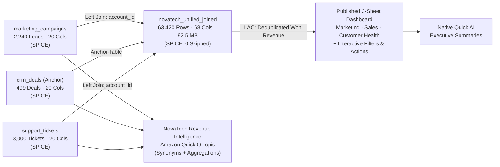

### Key Amazon Quick Calculated Fields & Level-Aware Calculation (`LAC`)

```sql
-- Level-Aware Calculation (novatech_unified_joined — eliminates 142.68x join fan-out)
Deduplicated Won Revenue (LAC) = sum(min({Won Revenue}, [{account_id}, {opportunity_id}]))

-- CRM Deals (crm_deals — list_price & deal_value typed as Decimal)
Won Revenue      = ifelse({deal_stage} = 'Won', {deal_value}, 0)
Is Won Deal      = ifelse({deal_stage} = 'Won', 1, 0)
Sales Cycle Days = dateDiff({deal_created_date}, {deal_closed_date}, 'DD')

-- Marketing Campaigns (marketing_campaigns — annual_income Decimal; Mkt_Src_Cd -> marketing_source_code)
Campaign ROI Pct  = ifelse({campaign_spend} > 0, ({revenue_attributed} - {campaign_spend}) / {campaign_spend}, 0)
Is Converted Lead = ifelse({funnel_stage} = 'Closed Won', 1, 0)

-- Support Tickets (support_tickets — exposes the 59 undocumented open-ticket blanks)
Resolution Time Days  = dateDiff({ticket_created_date}, {ticket_resolved_date}, 'DD')
Resolution Time Hours = dateDiff({ticket_created_date}, {ticket_resolved_date}, 'HH')
Sentiment Clean       = ifelse(isNull({customer_sentiment}) OR {customer_sentiment} = '', 'Open / Unresolved', {customer_sentiment})
```

---

## Live Visual Showcase

### 1. Published 3-Sheet Interactive Dashboard & Live Filter Proof (`1600×900`)

<table>
  <tr>
    <td width="50%" align="center">
      
      <br/>
      <strong>Sheet 1 — Marketing Funnel (Published)</strong><br/>
      <sub><code>$12.36M</code> Spend · <code>$1.13M</code> Attributed Rev · Direct Mail leads at <code>48.99%</code> conversion</sub>
    </td>
    <td width="50%" align="center">
      
      <br/>
      <strong>Sheet 2 — Sales Pipeline (Published)</strong><br/>
      <sub><code>$707,201.00</code> Won Revenue · <code>63.13%</code> Win Rate · Central <code>$274.29K</code> · Loss Reason Breakdown</sub>
    </td>
  </tr>
  <tr>
    <td width="50%" align="center">
      
      <br/>
      <strong>Sheet 3 — Customer Health &amp; LAC Table (Published)</strong><br/>
      <sub><code>3,000</code> Tickets · <code>1.95d</code> Avg · <code>Open / Unresolved</code> Sentiment · YieldMax <code>$40,722.00</code> (LAC)</sub>
    </td>
    <td width="50%" align="center">
      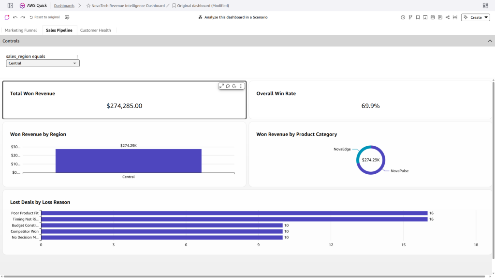
      <br/>
      <strong>Live Interactive Filter Verification (<code>sales_region = Central</code>)</strong><br/>
      <sub>Cross-filtering updates all Sheet 2 visuals dynamically to <code>$274,285.00</code> &amp; <code>69.9%</code> Win Rate</sub>
    </td>
  </tr>
</table>

### 2. Live SPICE Data Prep, 3-Table Left Join Diagram & LAC Formula

<table>
  <tr>
    <td width="50%" align="center">
      
      <br/>
      <strong>All 4 SPICE Datasets (<code>Owner: Me</code>, <code>0</code> Skipped Rows)</strong><br/>
      <sub><code>crm_deals</code> (<code>499</code>) · <code>marketing_campaigns</code> (<code>2,240</code>) · <code>support_tickets</code> (<code>3,000</code>) · <code>novatech_unified_joined</code> (<code>63,420</code>)</sub>
    </td>
    <td width="50%" align="center">
      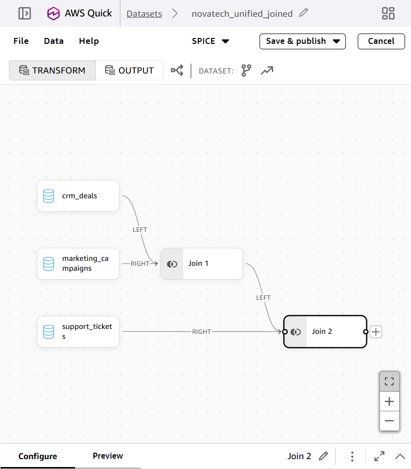
      <br/>
      <strong>Live 3-Table Left Join Topology</strong><br/>
      <sub><code>crm_deals</code> anchored Left Join to <code>marketing_campaigns</code> &amp; <code>support_tickets</code> on <code>account_id</code></sub>
    </td>
  </tr>
  <tr>
    <td width="50%" align="center">
      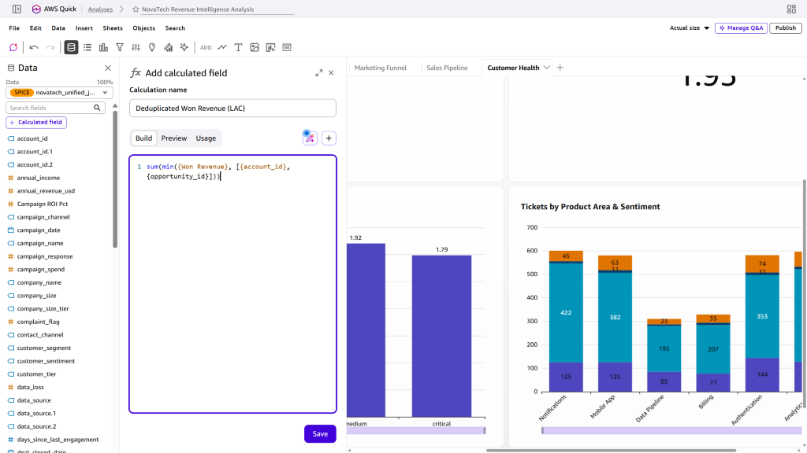
      <br/>
      <strong>Level-Aware Calculation (<code>Deduplicated Won Revenue (LAC)</code>)</strong><br/>
      <sub>Verified in-tool formula eliminating the <code>142.68x</code> join fan-out inside Sheet 3</sub>
    </td>
    <td width="50%" align="center">
      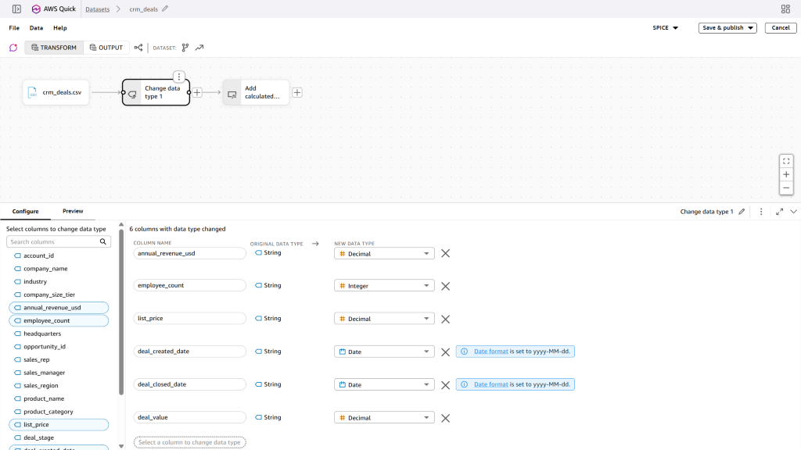
      <br/>
      <strong>Data Type Standardization in Amazon Quick Data Prep</strong><br/>
      <sub>Converting string fields to <code>Decimal</code>, <code>Integer</code>, and <code>Datetime</code> across <code>6</code> CRM columns</sub>
    </td>
  </tr>
</table>

### 3. AI-Powered BI: Q Topic Semantic Layer & Native Executive Summary

<table>
  <tr>
    <td width="50%" align="center">
      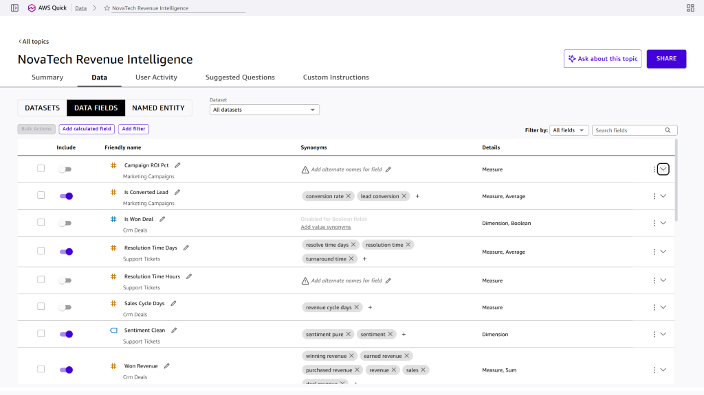
      <br/>
      <strong>Q Topic Semantic Layer Configuration</strong><br/>
      <sub>Business synonyms (<code>conversion rate</code>, <code>revenue</code>, <code>turnaround time</code>, <code>sentiment</code>) &amp; aggregations</sub>
    </td>
    <td width="50%" align="center">
      
      <br/>
      <strong>Post-Topic Q Query #1 (<code>Is Converted Lead</code> Synonym)</strong><br/>
      <sub>Deterministic bar chart + KPI: Direct Mail leads at <code>0.49</code> (<code>48.99%</code>) across <code>5</code> channels</sub>
    </td>
  </tr>
  <tr>
    <td width="50%" align="center">
      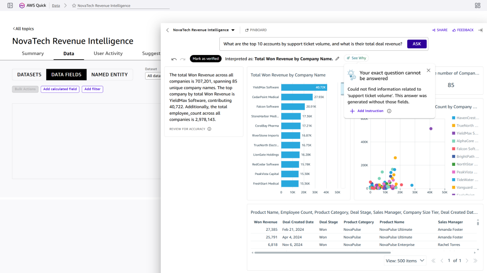
      <br/>
      <strong>Post-Topic Q3 — Single-Dataset Boundary Proof</strong><br/>
      <sub>Authentic Amazon Quick warning banner explaining why cross-table metrics belong in Sheet 3 (LAC)</sub>
    </td>
    <td width="50%" align="center">
      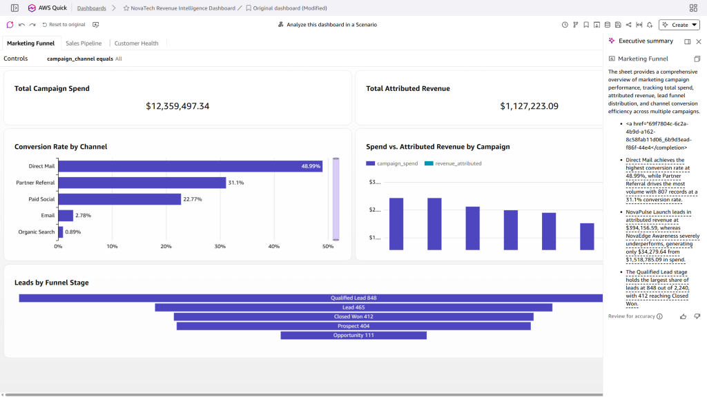
      <br/>
      <strong>Native Amazon Quick AI Executive Summary</strong><br/>
      <sub>Generated directly via <code>Create → Executive summary</code> on the published dashboard</sub>
    </td>
  </tr>
</table>

<details>
<summary><strong>Click to expand additional live AWS Quick evidence captures (Quick Chat Q9 Defect Audit, Unified SPICE Refresh, Post-Topic Q4 &amp; Customer Health Summary)</strong></summary>
<br/>
<table>
  <tr>
    <td width="50%" align="center">
      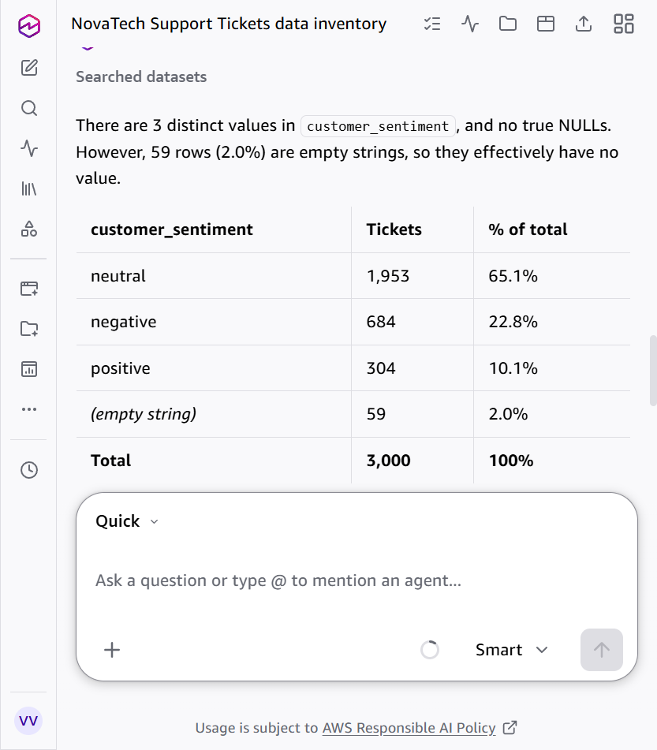
      <br/><sub>Quick Chat Q9: Confirming <code>59</code> undocumented empty-string values in <code>customer_sentiment</code></sub>
    </td>
    <td width="50%" align="center">
      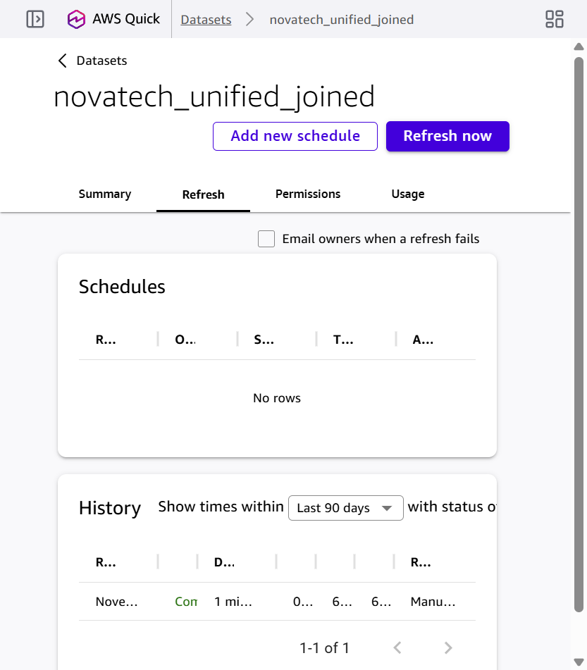
      <br/><sub>SPICE Refresh Completed: <code>63,420</code> ingested rows, <code>0</code> skipped rows</sub>
    </td>
  </tr>
  <tr>
    <td width="50%" align="center">
      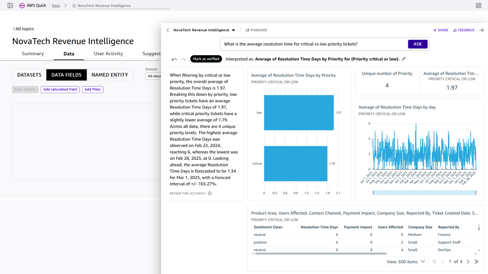
      <br/><sub>Post-Topic Q4: Critical (<code>1.79d</code>) vs. Low (<code>1.97d</code>) SLA resolution turnaround</sub>
    </td>
    <td width="50%" align="center">
      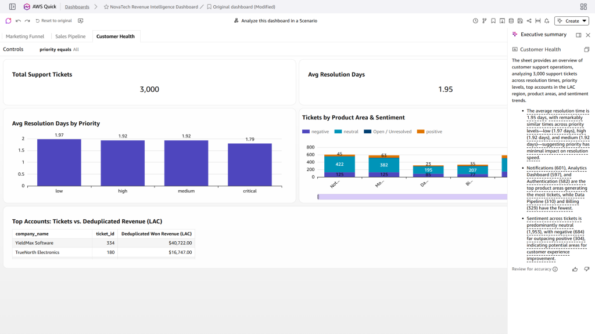
      <br/><sub>Published Dashboard AI Executive Summary — Sheet 3 (Customer Health)</sub>
    </td>
  </tr>
</table>
</details>

---

## Q Topic Before vs. After Evaluation

Full audit documented in [`Q_Exploration_Log.md`](05_TOPIC_AND_Q_EXPLORATION/Q_Exploration_Log.md) ([PDF](05_TOPIC_AND_Q_EXPLORATION/Q_Exploration_Log.pdf)):

| Query | Question Asked | Before Topic (Quick Chat) | After Topic (`NovaTech Revenue Intelligence`) | Published Dashboard Check | Alignment |
| :---: | :--- | :--- | :--- | :--- | :---: |
| **T1** | Highest-converting campaign channel? | Direct Mail `48.99%` (`73/149`) | `Average of Is Converted Lead` -> **Direct Mail `0.49`** | Direct Mail **`48.99%`** | **Exact Match** |
| **T2** | Average deal size by company size? | Proactively filtered Won (`$2,515` Enterprise) | `Average of Deal Value` across all 499 deals -> **`$1,417.24`** (`$1,589.17` Ent.) | `$707,201 / 499 = $1,417.24` (`$2,245.08` Won) | **Metric Definition Gap** |
| **T3** | Top 10 accounts by tickets + deal revenue? | Cross-queried both CSVs (`YieldMax $40,722`, `334` tkt) | Single-dataset warning banner; returned CRM Won Revenue only (`$707,201`) | Sheet 3 LAC table (`YieldMax 334 / $40,722.00`) | **Single-Dataset Limit** |
| **T4** | Avg resolution time: critical vs. low? | Critical `1.79d` vs. Low `1.97d` | `Average of Resolution Time Days` -> **Low `1.97` vs. Critical `1.79`** | Low **`1.97`** vs. Critical **`1.79`** | **Exact Match** |
| **T5** | Campaigns spending more than earned? | All 6 campaigns negative ROI (`-90.88%`) | All 6 campaigns: **`$12,359,497.34` Spend vs. `$1,127,223.09` Rev** | Exact match across all 6 bars | **Exact Match** |

---

## Strategic Recommendations for VP Sarah Chen

1. **Reallocate Marketing Budget (`Sheet 1`):** Shift spend out of **Organic Search (`0.89%` conversion, `-97.79%` ROI)** and **NovaEdge Awareness (`$34.3K` rev on `$1.52M` spend)** toward **Direct Mail (`48.99%` conversion)** and **Partner Referral (`251` Closed Won deals)**.
2. **Enforce Manager Pipeline Coaching (`Sheet 2`):** Pair **East (`57.81%` WR)** and **West (`58.79%` WR)** sales enablement with **Central (`69.90%` WR)** qualification playbooks to address the `86` losses driven equally by **No Decision Made (`43`)** and **Poor Product Fit (`43`)**.
3. **Establish Critical SLA Triage & Save At-Risk Enterprise Accounts (`Sheet 3`):** Introduce dedicated priority routing so **Critical** outages resolve far faster than **Low** tickets (`1.79d` vs. `1.97d` today), prioritizing **YieldMax Software (`334` tickets, `$40,722` Won)**, **TrueNorth Electronics (`180` tickets, `$16,747`)**, and **LionGate Holdings (`176` tickets, `$16,275`)**—part of **`$145,735.00`** in total at-risk enterprise revenue.

---

## Repository Structure & Deliverables

| Folder | Key Files | Purpose |
| :--- | :--- | :--- |
| **`00_START_HERE_AND_STARTER_FILES/`** | [README_SUBMISSION.md](00_START_HERE_AND_STARTER_FILES/README_SUBMISSION.md) · [RUBRIC_TRACEABILITY_CHECKLIST.xlsx](00_START_HERE_AND_STARTER_FILES/RUBRIC_TRACEABILITY_CHECKLIST.xlsx) · `starter_data/*.csv` | Resubmission index, rubric audit, Data Dictionary & starter CSVs |
| **`01_VERIFICATION_LOG/`** | [Verification_Log.pdf](01_VERIFICATION_LOG/Verification_Log.pdf) · [Verification_Log.md](01_VERIFICATION_LOG/Verification_Log.md) · `quick_chat_screenshots/` (`10` PNGs) | 10-entry live Quick Chat log with verbatim output & real captures |
| **`02_DATA_TRANSFORMATION/`** | `aws_quick_screenshots/` (`17` PNGs) · [Data_Transformation_and_ETL_Guide.pdf](02_DATA_TRANSFORMATION/Data_Transformation_and_ETL_Guide.pdf) · [etl_and_metrics_verifier.py](02_DATA_TRANSFORMATION/etl_and_metrics_verifier.py) | Live SPICE proofs, types, calc fields, LAC, 3-table joins & Python verifier |
| **`03_DASHBOARD_PDF_EXPORT/`** | [NovaTech_Revenue_Intelligence_Dashboard_All_3_Sheets.pdf](03_DASHBOARD_PDF_EXPORT/NovaTech_Revenue_Intelligence_Dashboard_All_3_Sheets.pdf) | 4-page PDF of the live Published Amazon Quick Dashboard (3 sheets + filter proof) |
| **`04_ANNOTATED_DASHBOARD_SCREENSHOTS/`** | `6` live Published Dashboard & Executive Summary PNGs · [Dashboard_Annotations_Guide.md](04_ANNOTATED_DASHBOARD_SCREENSHOTS/Dashboard_Annotations_Guide.md) | Live published sheets, `Central` filter proof, AI Executive Summaries & callouts |
| **`05_TOPIC_AND_Q_EXPLORATION/`** | [Q_Exploration_Log.pdf](05_TOPIC_AND_Q_EXPLORATION/Q_Exploration_Log.pdf) · `real_topic_before_after_screenshots/` (`9` PNGs) | Live Before vs. After Topic evaluation & 5-question Q Exploration Log |
| **`06_EXECUTIVE_SUMMARY_AND_REPORT/`** | [Executive_Report_for_VP_Sarah_Chen.pdf](06_EXECUTIVE_SUMMARY_AND_REPORT/Executive_Report_for_VP_Sarah_Chen.pdf) · [Dashboard_Executive_Summary.pdf](06_EXECUTIVE_SUMMARY_AND_REPORT/Dashboard_Executive_Summary.pdf) | 2-page strategic action report for VP Sarah Chen & Amazon Quick Executive Summaries |

---

## Reproducibility

Verify every metric, orphan account count (`150` Marketing / `204` Support), blank sentiment defect (`59`), and `142.68x` fan-out calculation locally from the starter CSVs:

```bash
git clone https://github.com/GhariebML/NovaTech-Revenue-Intelligence-Dashboard.git
cd NovaTech-Revenue-Intelligence-Dashboard
python 02_DATA_TRANSFORMATION/etl_and_metrics_verifier.py
```

---

## Author

**Mohamed Abd Elsalam Mohamed Gharieb**  
*AWS AI & ML Scholars Program — Future AWS Agentic AI Business Professional (Udacity)*  
GitHub: [@GhariebML](https://github.com/GhariebML)
