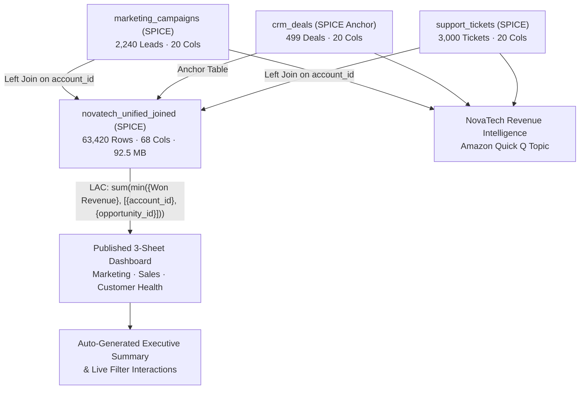
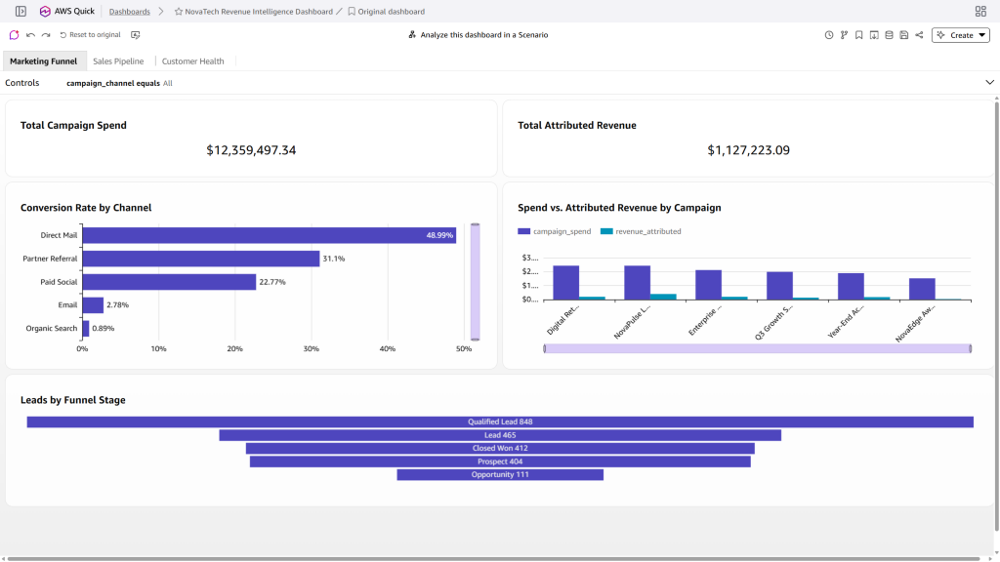
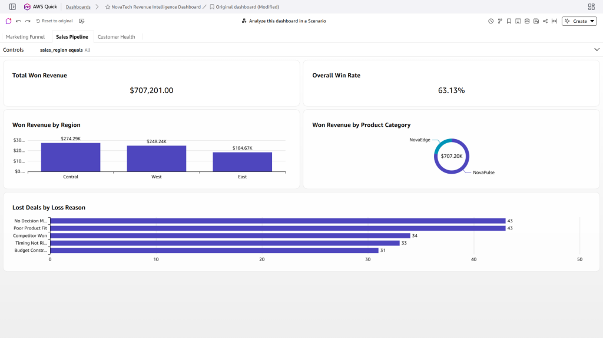
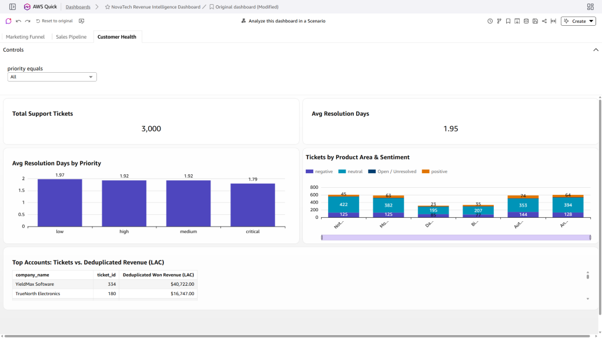
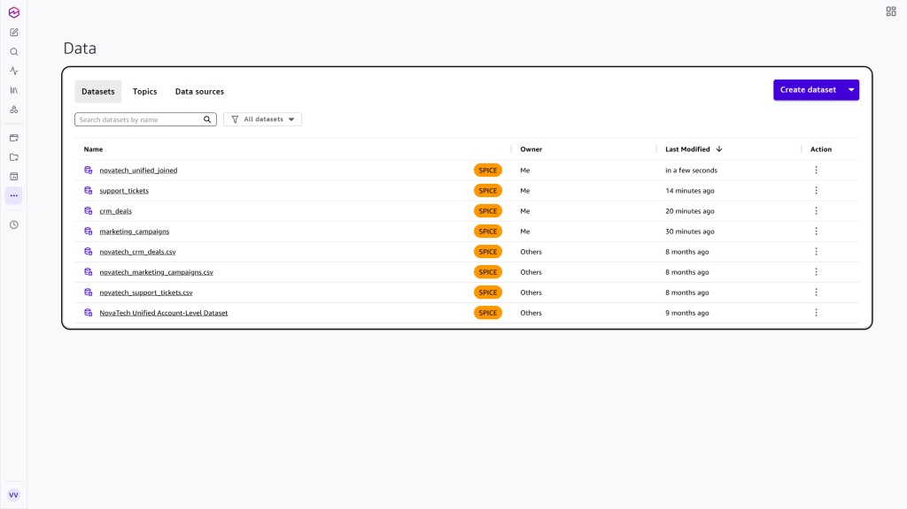
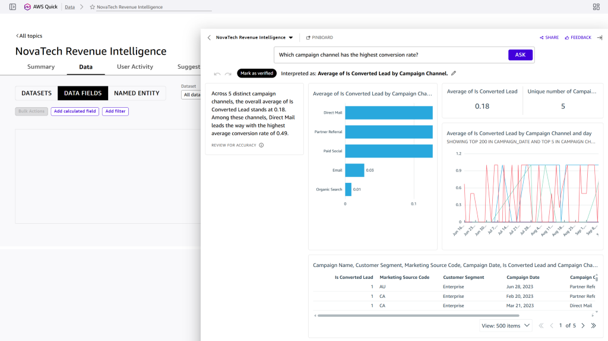

<p align="center">
  
</p>

<p align="center">
  
  
  
  
  
  
</p>

<p align="center">
  <a href="#executive-overview">Executive Overview</a> •
  <a href="#unified-spice-data-architecture">SPICE Architecture</a> •
  <a href="#headline-verified-kpis--live-discoveries">Verified KPIs</a> •
  <a href="#live-published-amazon-quick-dashboard">Published Dashboard</a> •
  <a href="#live-spice-joins-lac--q-topic-evidence">ETL, LAC & Q Topic</a> •
  <a href="#repository-structure--deliverables">Deliverables</a> •
  <a href="#reproducibility">Reproducibility</a>
</p>

---

## Executive Overview

This repository contains the complete, end-to-end **Revenue Intelligence & Semantic BI** capstone built **live inside Amazon Quick (`us-west-2`)** for **Course 2 of 3 (*Business Intelligence and Knowledge Management Foundations with Amazon Quick*)** in the **AWS AI & ML Scholars Program (Future AWS Agentic AI Business Professional)** on Udacity.

**Business Scenario:** NovaTech Solutions' VP of Revenue Operations (**Sarah Chen**) relied on fragmented Monday-morning spreadsheet merges across three disconnected operational systems:
- **Marketing Automation** (`marketing_campaigns` — **`2,240` leads**, `20` columns, `SPICE`)
- **CRM Sales Pipeline** (`crm_deals` — **`499` deals**, `20` columns, `SPICE`)
- **Customer Support** (`support_tickets` — **`3,000` tickets**, `20` columns, `SPICE`)

This project unifies all three knowledge bases inside **Amazon Quick / SPICE** (`novatech_unified_joined` — **`63,420` rows**, `68` columns, `0` skipped), neutralizes a **`142.68x` many-to-many join fan-out trap** using an in-tool **Level-Aware Calculation (`LAC`)**, tunes an **Amazon Quick Q Topic (`NovaTech Revenue Intelligence`)** with business synonyms and aggregations, and publishes a **3-Sheet Interactive Revenue Intelligence Dashboard** complete with live filter controls, filter actions, and auto-generated **Amazon Quick Executive Summaries**.

---

## Unified SPICE Data Architecture

A naive many-to-many join across Marketing × CRM × Support inflates `deal_value` from **`$707,201`** to **`$100,900,682`** (**`142.68x` overstatement**). Inside Amazon Quick, we anchor on `crm_deals` (`499` rows), Left Join `marketing_campaigns` & `support_tickets` on `account_id`, and protect cross-domain revenue visuals with a **Level-Aware Calculation (`LAC`)**:



---

## Headline Verified KPIs & Live Discoveries

| Domain | Verified Metric | Exact Value | Key Discovery (Live Amazon Quick Audit) |
| :--- | :--- | :---: | :--- |
| **Sales Pipeline** | Closed-Won Revenue (`315` Won / `499` Deals) | **`$707,201.00`** (`63.13%` Win Rate) | **Central** leads at **`$274.29K` (`69.9%` WR)**; Quick Chat also discovered **`3` reused `opportunity_id`s** (`496` unique IDs). |
| **Marketing Funnel** | Campaign Spend vs. Attributed Revenue | **`$12.36M` Spend / `$1.13M` Rev** (`-90.88%` ROI) | **Direct Mail** converts highest at **`48.99%`**, whereas **Organic Search** converts only **`0.89%`**. |
| **Customer Health** | Average Ticket Resolution Time (`3,000` Tickets) | **`1.95` days** (`1.79d` Critical vs. `1.97d` Low) | Minimal SLA triage separation between Critical outages and Low-priority tickets. |
| **LAC Fan-Out Fix** | Top At-Risk Account (`YieldMax Software`) | **`334` Tickets / `$40,722.00` Won Rev** | Computed live on `63,420`-row `novatech_unified_joined` via `sum(min({Won Revenue}, [{account_id}, {opportunity_id}]))` — eliminating `142.68x` fan-out (`$13.6M` naive sum). |
| **Data Quality Defect** | Undocumented `customer_sentiment` Blanks | **`59` empty strings (`1.97%`)** | Data Dictionary stated `Nulls: None`; live Quick Chat & SPICE audit confirmed `59` empty-string open tickets, mapped cleanly to **`Open / Unresolved`** in Sheet 3. |
| **Q Topic Governance** | Before vs. After Topic Audit | **Real Single-Dataset Limit Documented** | Live Q Topic excelled on single-domain queries (`T1`, `T4`, `T5`) but exposed a `$0` Lost-deal average (`T2`: `$1,417.24`) and single-dataset join limit (`T3`) — proving why cross-domain tables belong in the Published Dashboard. |

---

## Live Published Amazon Quick Dashboard

All screenshots below are **live captures (`1600×900`)** from our published **`NovaTech Revenue Intelligence Dashboard`** in Amazon Quick (`us-west-2`):

<table>
  <tr>
    <td width="50%" align="center">
      
      <br/>
      <strong>Sheet 1 — Marketing Funnel (Published)</strong><br/>
      <sub>$12.36M Spend, $1.13M Attributed Rev, Direct Mail 48.99% Conv & Channel Filter</sub>
    </td>
    <td width="50%" align="center">
      
      <br/>
      <strong>Sheet 2 — Sales Pipeline (Published)</strong><br/>
      <sub>$707,201 Won Revenue, 63.13% Win Rate, Region Bars, Product Donut & Loss Reasons</sub>
    </td>
  </tr>
  <tr>
    <td width="50%" align="center">
      
      <br/>
      <strong>Sheet 3 — Customer Health + LAC Deduplication</strong><br/>
      <sub>3,000 Tickets, 1.95d Avg, Open/Unresolved Sentiment & YieldMax $40,722 LAC Table</sub>
    </td>
    <td width="50%" align="center">
      
      <br/>
      <strong>Live Interactive Filter Proof (Central Region)</strong><br/>
      <sub>Filtering sales_region = Central dynamically updates KPIs to $274,285.00 & 69.9%</sub>
    </td>
  </tr>
</table>

---

## Live SPICE Joins, LAC & Q Topic Evidence

<table>
  <tr>
    <td width="50%" align="center">
      
      <br/>
      <strong>4 Imported SPICE Datasets (Owner: Me)</strong><br/>
      <sub>crm_deals (499), marketing_campaigns (2,240), support_tickets (3,000), novatech_unified_joined (63,420)</sub>
    </td>
    <td width="50%" align="center">
      
      <br/>
      <strong>Live 3-Table Left Join Diagram (SPICE)</strong><br/>
      <sub>crm_deals anchored Left Join to marketing_campaigns & support_tickets on account_id</sub>
    </td>
  </tr>
  <tr>
    <td width="50%" align="center">
      
      <br/>
      <strong>Amazon Quick Q Topic Semantic Layer</strong><br/>
      <sub>Custom business synonyms & default aggregations configured in NovaTech Revenue Intelligence</sub>
    </td>
    <td width="50%" align="center">
      
      <br/>
      <strong>Auto-Generated Amazon Quick Executive Summary</strong><br/>
      <sub>Native Create → Executive summary AI side pane on the published dashboard</sub>
    </td>
  </tr>
</table>

<details>
<summary><strong>Click to expand additional live Amazon Quick LAC formula & Before/After Q Topic screenshots</strong></summary>
<br/>
<table>
  <tr>
    <td width="50%" align="center">
      
      <br/><sub>Level-Aware Calculation: sum(min({Won Revenue}, [{account_id}, {opportunity_id}]))</sub>
    </td>
    <td width="50%" align="center">
      
      <br/><sub>Post-Topic Q1: Average of Is Converted Lead by Campaign Channel (Direct Mail 0.49)</sub>
    </td>
  </tr>
  <tr>
    <td width="50%" align="center">
      
      <br/><sub>Post-Topic Q3: Authentic Single-Dataset Topic Limitation Banner</sub>
    </td>
    <td width="50%" align="center">
      
      <br/><sub>Post-Topic Q4: Resolution Time Days Critical (1.79) vs. Low (1.97)</sub>
    </td>
  </tr>
</table>
</details>

---

## Repository Structure & Deliverables

| Folder | Key Deliverables | Description |
| :--- | :--- | :--- |
| **`00_START_HERE_AND_STARTER_FILES/`** | [README_SUBMISSION.md](00_START_HERE_AND_STARTER_FILES/README_SUBMISSION.md) · [RUBRIC_TRACEABILITY_CHECKLIST.xlsx](00_START_HERE_AND_STARTER_FILES/RUBRIC_TRACEABILITY_CHECKLIST.xlsx) · `starter_data/*.csv` | Resubmission index, rubric traceability audit, starter datasets & Data Dictionary |
| **`01_VERIFICATION_LOG/`** | [Verification_Log.pdf](01_VERIFICATION_LOG/Verification_Log.pdf) · [Verification_Log.md](01_VERIFICATION_LOG/Verification_Log.md) · `quick_chat_screenshots/` (`10` PNGs) | 10-entry live Quick Chat verification log with verbatim answers & real screenshots |
| **`02_DATA_TRANSFORMATION/`** | `aws_quick_screenshots/` (`17` PNGs) · [Data_Transformation_and_ETL_Guide.pdf](02_DATA_TRANSFORMATION/Data_Transformation_and_ETL_Guide.pdf) · [etl_and_metrics_verifier.py](02_DATA_TRANSFORMATION/etl_and_metrics_verifier.py) | Live SPICE import proofs, data types, calculated fields, LAC formula, 3-table Join diagram & Python audit |
| **`03_DASHBOARD_PDF_EXPORT/`** | [NovaTech_Revenue_Intelligence_Dashboard_All_3_Sheets.pdf](03_DASHBOARD_PDF_EXPORT/NovaTech_Revenue_Intelligence_Dashboard_All_3_Sheets.pdf) | 4-page PDF of the real Published Amazon Quick Dashboard (all 3 sheets + live filter proof) |
| **`04_ANNOTATED_DASHBOARD_SCREENSHOTS/`** | `6` live Published Dashboard & Executive Summary PNGs · [Dashboard_Annotations_Guide.md](04_ANNOTATED_DASHBOARD_SCREENSHOTS/Dashboard_Annotations_Guide.md) | Live published sheets, interactive Central filter proof, AI Executive Summaries & callouts |
| **`05_TOPIC_AND_Q_EXPLORATION/`** | [Q_Exploration_Log.pdf](05_TOPIC_AND_Q_EXPLORATION/Q_Exploration_Log.pdf) · `real_topic_before_after_screenshots/` (`9` PNGs) | Live Before vs. After Topic evaluation & 5-question Q Exploration Log |
| **`06_EXECUTIVE_SUMMARY_AND_REPORT/`** | [Executive_Report_for_VP_Sarah_Chen.pdf](06_EXECUTIVE_SUMMARY_AND_REPORT/Executive_Report_for_VP_Sarah_Chen.pdf) · [Dashboard_Executive_Summary.pdf](06_EXECUTIVE_SUMMARY_AND_REPORT/Dashboard_Executive_Summary.pdf) | 2-page strategic action report for VP Sarah Chen & verbatim Amazon Quick Executive Summaries |

---

## Reproducibility

Verify every metric, join cardinality count, orphan record count, and fan-out multiplier directly from the starter CSVs:

```bash
git clone https://github.com/GhariebML/NovaTech-Revenue-Intelligence-Dashboard.git
cd NovaTech-Revenue-Intelligence-Dashboard
python 02_DATA_TRANSFORMATION/etl_and_metrics_verifier.py
```

---

## Author

**Mohamed Abd Elsalam Mohamed Gharieb**  
*AWS AI & ML Scholars Program — Future AWS Agentic AI Business Professional (Udacity)*  
GitHub: [@GhariebML](https://github.com/GhariebML)
